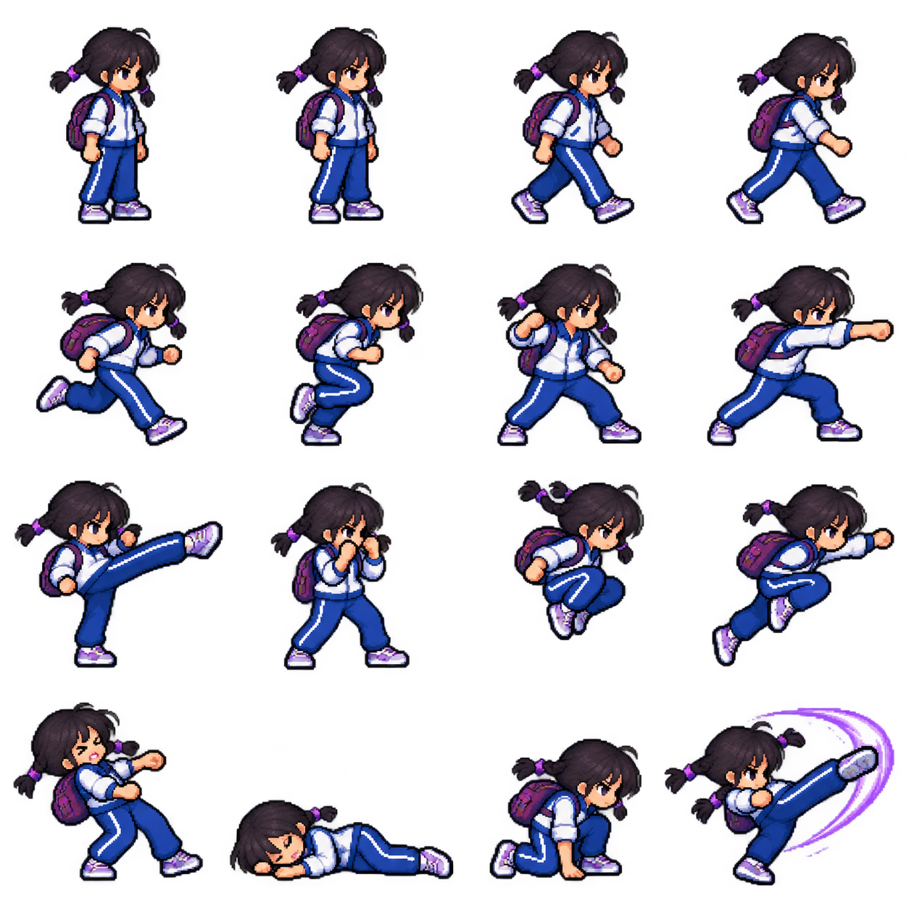
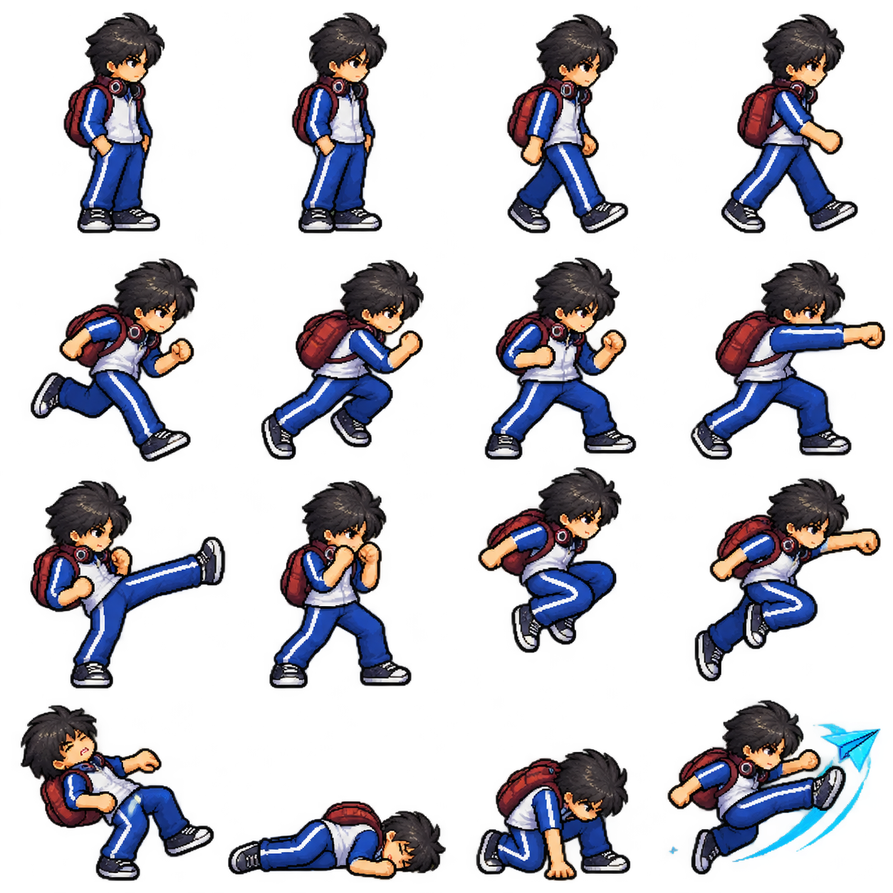
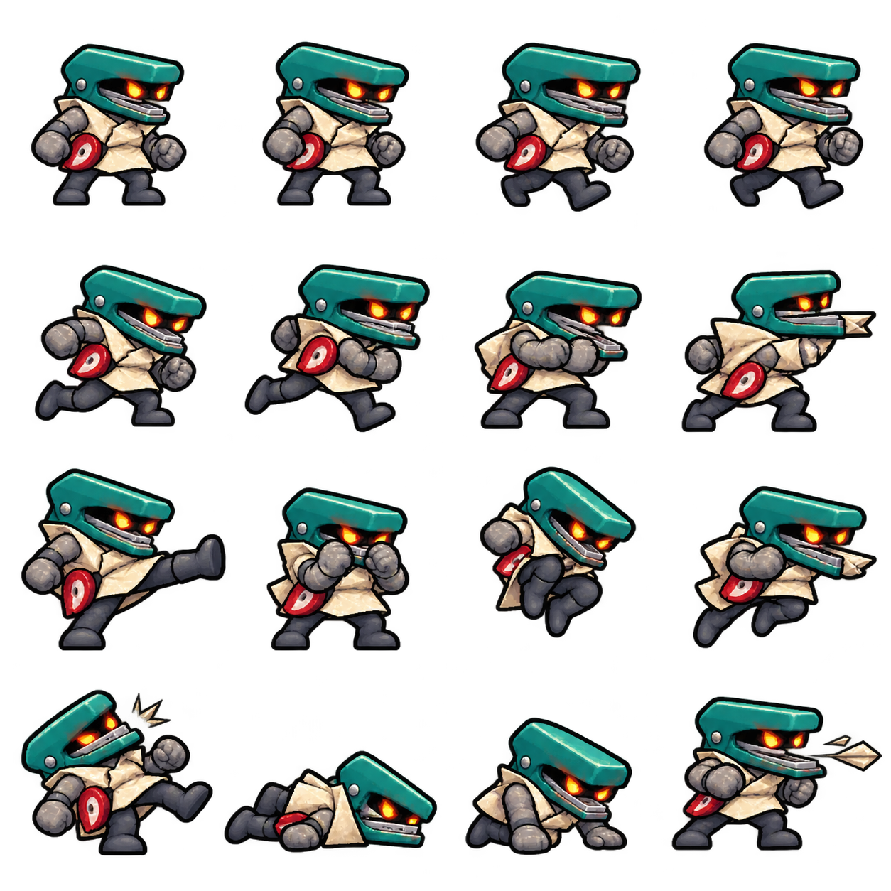
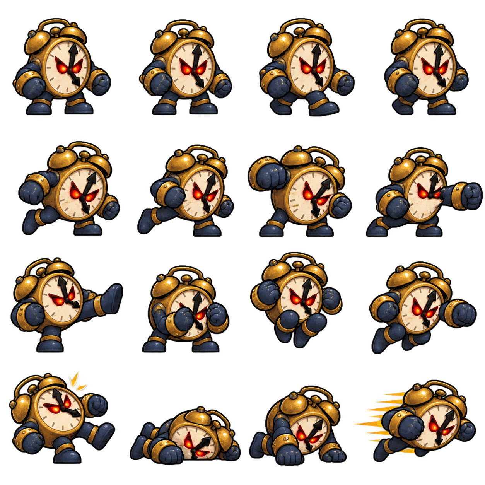

# 《與名為現實的怪物戰鬥的人們》資產擴充

本批補入 2 位可玩夥伴、2 種怪物與 2 處場景，延續中式校園、荒誕現實與像素橫版戰鬥的美術方向。擴充後共有 **6 位夥伴、27 項專屬技能、3 種怪物、5 處場景**。

本次使用新圖像呈現既有 LF2 動作與場景。原有 11 位角色的動作資料保留不變；兩種新怪物另建角色 ID，使用已存在角色的動作資料複本。戰鬥沿用各自模板的動作時間、耗藍、碰撞與傷害判定；角色以原生 **200 MP** 開局，仍使用連續輸入的 LF2 組合鍵，沒有新增單鍵施法。

## 新增夥伴

### 唐梨

紫色雙辮、藍白校服的踢技夥伴，擅長近身連踢、持續突進與追蹤光彈。沿用 **Dennis，角色 ID 9**，共 4 招。

| 招式 | 原生組合 | MP |
| --- | --- | ---: |
| 粉筆連彈 | 防禦 → 前方 → 攻擊 | 首發 40 |
| 課間連踢 | 防禦 → 下 → 攻擊 | 75 |
| 放學旋風 | 防禦 → 前方 → 跳躍 | 起動 75，持續旋轉每輪另耗 34 |
| 追問光點 | 防禦 → 上 → 攻擊 | 100 |

「粉筆連彈」出手後按攻擊，第二發另耗 40 MP；再續按攻擊，雙發段另耗 70 MP。四發收招時按攻擊進入回接段，隨後會自動銜接下一輪首發，無需再補一次攻擊，回接首發不額外耗 MP；後續第二發與雙發段仍需按攻擊並支付相應 MP。「放學旋風」可用防禦或跳躍提前收招，MP 用完也會停止。

### 沈舟

帶著深紅書包、頸掛耳機的少年，擅長雙彈牽制、掃踢與瞬移接近敵人或同伴。沿用 **Woody，角色 ID 10**，共 6 招。

| 招式 | 原生組合 | MP |
| --- | --- | ---: |
| 雙頁推進 | 防禦 → 前方 → 攻擊 | 125 |
| 逆風起身 | 防禦 → 上 → 攻擊 | 0 |
| 橫越題海 | 防禦 → 下 → 攻擊 | 50 |
| 越線飛踢 | 防禦 → 前方 → 跳躍 | 200 |
| 直面現實 | 防禦 → 上 → 跳躍 | 50 |
| 回到同伴 | 防禦 → 下 → 跳躍 | 50 |

「雙頁推進」一次自動發出兩彈，共耗 125 MP。「直面現實」靠近最近的敵人，「回到同伴」靠近最遠的同隊夥伴；沒有對應目標時仍耗 MP。瞬移收招可接「逆風起身」或「越線飛踢」，落地與部分動作收招也保留原生飛踢派生。

「前方」代表選擇左或右出招，不必先轉身。各按鍵要依次輸入；遊戲內出招表會顯示目前玩家的實際鍵位。

## 新增怪物

### 訂正獵手

將訂正、裝訂與反覆退回的作業化為敵人。這是本次新增的校園怪物，**角色 ID 31**；以現有 **Henry（ID 4）** 的原生動作資料複本驅動遠程射擊與移動，讓玩家在接近敵人時需要留意射線。其動作、耗藍與判定維持 Henry 模板。

### 催促鐘怪

把「快一點」與倒數聲具象化。這是本次新增的校園怪物，**角色 ID 32**；以現有 **Louis（ID 6）** 的原生動作資料複本驅動近身重擊，與紙卷怪、訂正獵手形成不同的交戰距離。其動作、耗藍與判定維持 Louis 模板。

既有紙卷怪仍保留。自由對戰可選單一怪物，也可使用「混合編隊」輪流配置三種怪物；怪物數量可另外調整。

## 新增場景

### 教室 · 名字慢慢寫

從校門進入教室，將課桌與黑板變為下一段並肩作戰的地方。選單索引為 **3**，場景 ID 為 **404**，沿用原生背景 **4** 的場地配置。

### 高中 · 下一題

考試與下一道題不斷延伸的高中場景，可在自由對戰中選擇。選單索引為 **4**，場景 ID 為 **405**，沿用原生背景 **4** 的場地配置。

原有小學校門、初中排名場與大學畢業場景保留，合計 5 處。新增高中場景提供對戰場地，不表示高中劇情章節已完成。

## 如何進入

1. 刷新遊戲首頁，點「一起出发」，在選角畫面切到「自由对战」。
2. 分別選擇 P1／P2，再點唐梨或沈舟的角色卡；也可與原有四位夥伴搭配。
3. 在「怪物編隊」選「混合編隊」、訂正獵手或催促鐘怪；在「战斗场景」選教室或高中場景，然後開始對戰。
4. 點首頁、選角畫面或戰鬥中的「全技能出招表／技能」，查看全部 6 位夥伴的 27 招與當前鍵位。
5. 選第一章「不要掉隊」體驗故事：第一段為校門口；通過檢查點後，第二段進入教室，面對紙卷怪、訂正獵手與催促鐘怪的三怪編隊。

雙人預設操作維持：P1 使用 WASD 移動、F 攻擊、G 跳躍、H 防禦；P2 使用方向鍵移動、J 攻擊、K 跳躍、L 防禦。已自訂的鍵位以遊戲設定為準。

## 資產與動畫範圍

新增的兩位角色與兩種怪物，各提供一張 **4 × 4、共 16 種姿勢**的透明像素圖集。執行時會依原生動作狀態選取、映射並重用這些姿勢，搭配既有幀資料運作。這批是可玩的姿勢映射素材，**並非每一個原生動畫幀都有獨立重繪的完整動畫**。

| 資產 | 原始 PNG |
| --- | --- |
| 唐梨 | [tangli.png](../vendor/F.LF/game/art/tangli.png) |
| 沈舟 | [shenzhou.png](../vendor/F.LF/game/art/shenzhou.png) |
| 訂正獵手 | [stapler-monster.png](../vendor/F.LF/game/art/stapler-monster.png) |
| 催促鐘怪 | [clock-monster.png](../vendor/F.LF/game/art/clock-monster.png) |
| 教室 · 名字慢慢寫 | [stage-classroom.png](../vendor/F.LF/game/art/stage-classroom.png) |
| 高中 · 下一題 | [stage-exam.png](../vendor/F.LF/game/art/stage-exam.png) |

來源與整合記錄見 [asset-expansion-manifest.json](../assets/runtime/asset-expansion-manifest.json)。
